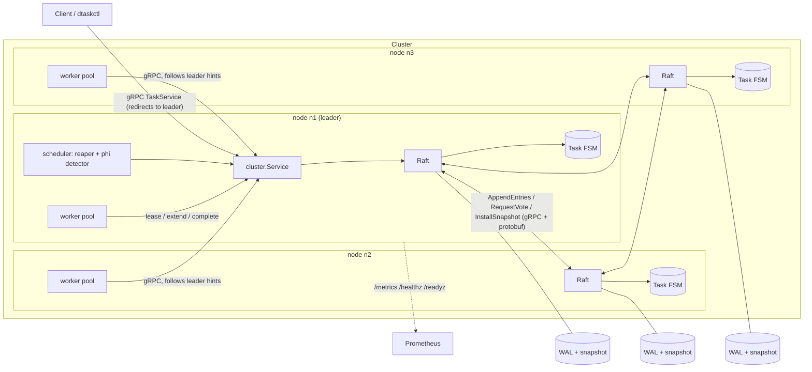
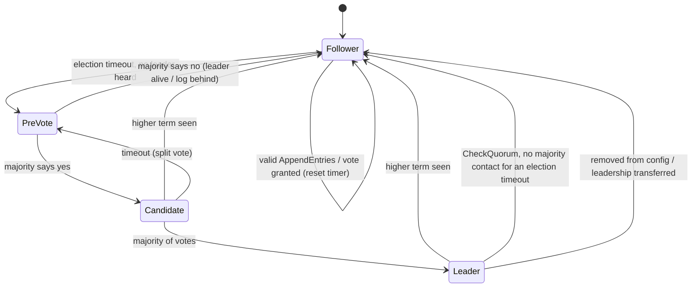
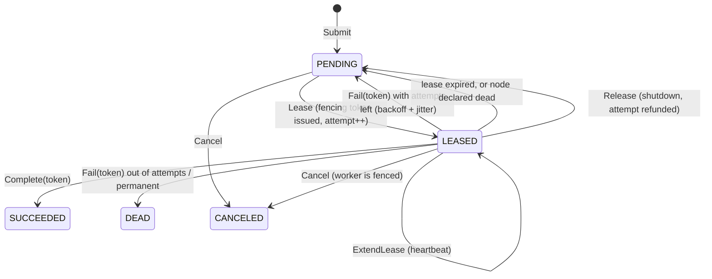

# dtask

[](https://github.com/monaaoua9/dtask/actions/workflows/ci.yml)
[](https://github.com/monaaoua9/dtask/releases)
[](LICENSE)
[](go.mod)

A distributed task execution and scheduling engine in Go. Every node runs the
same binary; together they form a Raft cluster that stores the task queue,
hands work to workers under fenced leases, and keeps going when machines die.

The consensus layer is written from scratch (no `hashicorp/raft`, no `etcd`),
including pre-vote, leader stickiness, CheckQuorum, snapshots, learner-based
membership changes, ReadIndex reads and leadership transfer. It is exercised by
a fault-injection suite that kills nodes, cuts links, drops and delays packets
while checking invariants on the result.

```
$ dtaskctl submit --type sleep --payload 2s
01a174b227923084fd512e923a23d7fc
$ dtaskctl status
answered by n1 (leader), term 2, leader n1
ID  ADDRESS         VOTER  HEALTHY  PHI
n1  127.0.0.1:7001  true   true     0.0
n2  127.0.0.1:7002  true   true     0.1
n3  127.0.0.1:7003  true   true     0.1
```

**Contents:**
[Guarantees](#what-it-guarantees) ·
[Architecture](#architecture) ·
[Running it](#running-it) ·
[Observability](#observability) ·
[Testing](#testing) ·
[Limits](#limits-worth-knowing) ·
[Design notes](docs/ARCHITECTURE.md)

## What it guarantees

| Property | How |
|---|---|
| Tasks survive node loss | Every state change is a Raft log entry, committed on a majority and fsynced before it is acknowledged. |
| A task never runs *to completion* twice | Leases carry a fencing token from a counter inside the replicated state machine. `Complete`/`Fail`/`Extend` with a stale token is rejected, so a worker that was paused or partitioned cannot overwrite the result of the worker that replaced it. |
| Submitting twice doesn't enqueue twice | Idempotency keys per queue. The client library adds one automatically, so retries after a lost response are safe. |
| Dead nodes' work moves quickly | A phi-accrual failure detector on the leader watches Raft heartbeat arrivals. When a node crosses the threshold, every lease held by that node's workers is returned to the queue in a single log entry, without waiting for the lease TTL. The TTL remains the backstop. |
| Failures back off, they don't stampede | Retries use exponential backoff with full jitter. The delay is chosen once on the leader and written into the log entry, so replicas never need a random number generator. |
| Shutdown doesn't drop work | SIGTERM stops leasing, lets running tasks finish, hands unfinished ones back (without costing an attempt) once the deadline passes, then transfers leadership before closing. |
| Per-queue rate and concurrency limits hold cluster-wide | Token bucket and in-flight cap live in the state machine and are evaluated at lease time, integer math only. |

Execution is **at-least-once** (a task interrupted by a crash runs again);
*completion* is recorded **exactly once**. Handlers with external side effects
should still be idempotent, or use the task id as their idempotency key.

## Architecture



Writes go to the leader, which stamps the wall clock and any random choices
into a command, appends it to the log, waits for a majority, and then every
node applies it to its own copy of the task state machine. The state machine
never reads a clock or a random source, so replicas stay bit-identical (the
tests compare SHA-256 digests of their snapshots).

### Raft, in this codebase



| Mechanism | Why it's there |
|---|---|
| **Pre-vote** | A node that was partitioned away keeps timing out. Without pre-vote it would inflate its term and depose a healthy leader when it came back. The probe doesn't change anyone's term. |
| **Leader stickiness** | Voters ignore vote requests while they've heard from a leader within the minimum election timeout. Removed servers can't disrupt the cluster either. |
| **CheckQuorum** | A leader that can't reach a majority steps down instead of accepting writes it can never commit. |
| **No-op on election** | A leader only counts replicas for entries from its own term; the no-op commits everything before it. Config changes and read barriers wait for it. |
| **Fast log backtracking** | Followers return the conflicting term and the first index of it, so a diverged follower catches up in one round trip per term rather than per entry. |
| **Snapshots** | The FSM is serialised once enough entries are applied and the log is compacted. Followers too far behind get `InstallSnapshot`. The WAL is rewritten atomically. |
| **Membership changes** | One server at a time (the single-server algorithm from the Raft thesis). New nodes join as non-voting learners, catch up, then get promoted, so a slow newcomer never stalls commits. |
| **ReadIndex** | `GetTask`/`ListTasks` are linearizable: the leader confirms it's still leader with a heartbeat round that is *provably sent after* the read started (logical send counter, not wall time), then waits for its state machine to reach the commit index. |
| **Leadership transfer** | On graceful shutdown the leader brings the most up-to-date follower level and sends `TimeoutNow`, so failover takes a vote round instead of an election timeout. |

### Task lifecycle



## Running it

### Locally

```sh
make build                       # bin/dtaskd, bin/dtaskctl

PEERS=n1=127.0.0.1:7001,n2=127.0.0.1:7002,n3=127.0.0.1:7003
for i in 1 2 3; do
  bin/dtaskd --id n$i --listen 127.0.0.1:700$i --http 127.0.0.1:909$i \
             --data-dir /tmp/dtask/n$i --peers $PEERS &
done

export DTASK_ADDR=127.0.0.1:7001,127.0.0.1:7002,127.0.0.1:7003
bin/dtaskctl status
bin/dtaskctl submit --type echo --payload hello
bin/dtaskctl submit --type flaky --payload 2 --max-attempts 5     # fails twice, then works
bin/dtaskctl list
bin/dtaskctl queue-config --name default --rate 50 --burst 10     # cluster-wide limit
```

Kill the leader (`kill -9`) and keep submitting: the client follows the new
leader on its own. Start a fourth node later with
`dtaskd --id n4 --listen ... --join --seeds 127.0.0.1:7001`.

### Docker

```sh
make cluster          # 3 nodes + Prometheus on :9090 + Grafana dashboard on :3000 (alert rules in deploy/alerts.yml)
docker compose -f deploy/docker-compose.yml kill n1
```

### Mutual TLS

`--tls-cert/--tls-key/--tls-ca` (or `DTASK_TLS_*`) turn on TLS 1.3 with client
certificates for peer, client and worker traffic. `dtaskctl` takes the same flags.

### Writing handlers

Handlers are plain functions registered by task type (`internal/demo` has
examples). Return an error to retry, wrap it with `worker.Permanent` to skip the
remaining attempts. The context is cancelled if the lease is lost or the node
is shutting down hard.

```go
"resize": func(ctx context.Context, t *pb.Task) ([]byte, error) {
    img, err := decode(t.Payload)
    if err != nil {
        return nil, worker.Permanent(err)   // retrying a corrupt payload is pointless
    }
    return resize(ctx, img)
},
```

## Observability

`/metrics` (Prometheus), `/healthz` (process up), `/readyz` (node knows a leader
and isn't draining), `/debug/pprof` with `--debug`. Highlights:

| Metric | Meaning |
|---|---|
| `dtask_raft_role`, `_term`, `_commit_index`, `_applied_index`, `_last_log_index` | consensus state per node |
| `dtask_raft_elections_total{phase,outcome}`, `_leader_changes_total`, `_quorum_step_downs_total` | election churn |
| `dtask_raft_commit_latency_seconds` | propose → applied on the leader |
| `dtask_tasks{queue,state}` | queue depth, read from the state machine at scrape time |
| `dtask_queue_wait_seconds{queue}` | how long runnable tasks wait for a worker |
| `dtask_fenced_requests_total` | zombie workers caught by fencing |
| `dtask_leases_expired_total`, `dtask_node_failover_tasks_total` | work recovered after failures |
| `dtask_worker_in_flight`, `_executions_total`, `_execution_seconds` | per-node worker activity |
| `dtask_grpc_requests_total{method,code}`, `_request_seconds` | API traffic |

## Testing

```sh
make test      # everything
make race      # with the race detector (needs a C toolchain)
make chaos     # the fault-injection suites, 3x each
make soak      # DURATION=20m: sustained load + leader crashes, watches goroutines and heap
```

| Suite | What it checks |
|---|---|
| `internal/raft` | Single leader per term (a background watcher records every observed leader), replication, crash/restart on memory and on-disk stores, minority leader steps down and its writes never "succeed", pre-vote, snapshot catch-up, read barriers, membership add/remove/remove-leader, leadership transfer, and a seeded random-fault soak where acknowledged writes must survive and appear exactly once. |
| `internal/raft/wal` | Torn tail write, flipped byte, crash between snapshot and WAL trim, truncation, compaction. |
| `internal/fsm` | Every command, fencing, rate limiting (including sub-millisecond polling), snapshot/restore, and a randomised test that applies the same commands to two replicas, one rebuilt from a snapshot halfway, and demands identical results and digests. |
| `internal/linearize` | The checker itself, tested on known good and bad histories. |
| `internal/node` | Whole system over a simulated network: exactly-once under no faults, leader crash mid-flight, follower crash redistributes before lease expiry, **partitioned zombie worker is fenced** and the stored result belongs to the winning lease, graceful drain, shutdown past deadline, cluster-wide rate limit, membership change, and a chaos run (random crashes with restart from disk, partitions, 10% packet loss, latency) checking that no task is lost, no fencing token is issued twice, and all replicas end identical, plus a **linearizability check**: concurrent clients lease, complete, release and read tasks during the same kind of chaos, and a Wing & Gong checker (`internal/linearize`) verifies each task's recorded history against the lease/fencing model. |
| `internal/node` (gRPC) | Real sockets: leader killed under load, client redirect, idempotent submit, pagination, join, graceful handoff, `/metrics`, and the same cluster over mutual TLS. |

The network is simulated by `internal/raft/simnet`: partitions (including
one-way), isolation, latency and loss, with timeouts behaving the way a real
dropped packet does.

## Layout

```
api/proto/dtask/v1/     wire protocol: raft, task, admin, FSM commands (buf)
api/gen/                generated code (committed, CI checks it's current)
cmd/dtaskd/             the node binary
cmd/dtaskctl/           CLI
internal/raft/          consensus: node, log, replication, handlers, membership, transfer
internal/raft/wal/      on-disk store
internal/raft/simnet/   fault-injecting in-process network
internal/raft/grpctransport/
internal/fsm/           deterministic task state machine
internal/cluster/       leader-side service: validation, clock/backoff stamping, metrics
internal/scheduler/     reaper, GC, failure detection
internal/failure/       phi accrual detector
internal/backoff/       exponential backoff with jitter
internal/worker/        lease heartbeats, execution, graceful drain
internal/server/        gRPC + HTTP servers, error mapping
internal/node/          wiring, startup/shutdown order, system tests
pkg/client/             Go client with leader discovery and retries
docs/ARCHITECTURE.md    design notes and trade-offs
```

## Limits worth knowing

- One Raft group holds all queues, so write throughput is bounded by a single
  leader. Proposals are group-committed (one fsync per batch); on my laptop
  (i5-8365U) a single node with a real WAL does ~28k commits/s and 3 in-process
  nodes ~139k/s with memory stores (`go test -bench Propose ./internal/raft`).
  Sharding queues across groups is the long-term answer.
- Snapshots travel in one gRPC message and the FSM is held in memory.
- Membership changes are single-server, not joint consensus.
- Leases and retry times use the leader's wall clock; skew between leaders
  shifts timing but cannot break correctness, because the state machine only
  ever sees the timestamps written into the log (and never moves its clock back).
- Finished tasks are garbage-collected after `--retention`, which is also how long
  an idempotency key is remembered.

## Status

Built as a study in distributed-systems correctness: the interesting part is not
the feature list but the evidence. Every guarantee above has a test that tries
to break it, and the test suite itself was checked by deliberately breaking the
code (fencing that ignores the token, reads without the read barrier, a WAL that
keeps torn tails) and confirming the tests fail. If you intend to operate a
system like this in production, reach for `etcd`/`hashicorp/raft` underneath;
this repository shows how the pieces work and how to test them.

Design reasoning and trade-offs are in [docs/ARCHITECTURE.md](docs/ARCHITECTURE.md).

## License

MIT, see [LICENSE](LICENSE).
