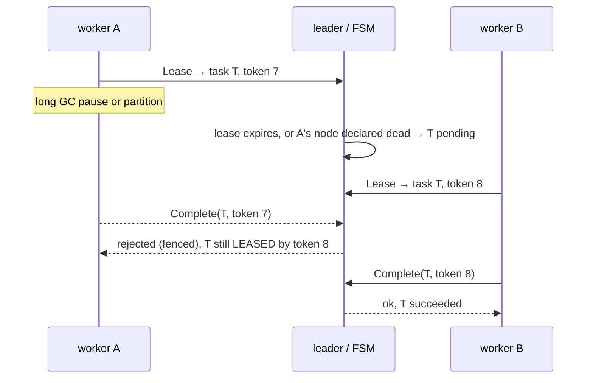

# Design notes

## 1. Layers

```
 clients, workers ──gRPC──►  cluster.Service      validate, stamp time/backoff, build a Command
                                   │ Propose(bytes)
                                   ▼
                             raft.Node            replicate, commit, order
                                   │ Apply(bytes)   (same order on every node)
                                   ▼
                              fsm.FSM             deterministic task state
```

`raft` knows nothing about tasks: it replicates opaque byte strings and calls
`FSM.Apply`. `fsm` knows nothing about networks. `cluster.Service` is the only
place where "now" and "random" enter the system, and it writes them into the
command before the command is replicated.

## 2. Determinism rules for the state machine

Replicas stay identical only if `Apply` is a pure function of (state, command).
So inside `internal/fsm`:

- no `time.Now()`; every command carries `now_ns`, and the FSM keeps
  `clock = max(clock, now_ns)` so a new leader with a slower wall clock cannot
  move time backwards;
- no randomness; the retry delay (backoff + jitter) is computed by the leader
  and sent as `retry_at_ns`;
- no observable dependence on map iteration order (reaping iterates a map, but
  each task is handled independently, and heap order uses `(priority, seq)`
  which is unique);
- rate limiting uses integer milli-tokens and 128-bit multiply/divide, no floats;
- read-only helpers (`HasReady`) may only discard dead heap entries, never
  promote or refill, because they run on the leader at *its* clock and must not
  make that replica differ from the others. There is a test for this
  (`TestHasReadyDoesNotChangeReplicatedState`).

`TestReplicasStayIdenticalUnderRandomCommands` applies random command streams to
two FSMs, rebuilds one from a snapshot halfway through, and compares every
result and the final SHA-256 digest.

## 3. Leases, fencing and why there's no separate lock service

A lease is the distributed lock. `Lease` pops the best runnable task and stamps
it with `lease_token = next_token++` and an expiry. Every later call from the
worker (`Extend`, `Complete`, `Fail`, `Release`) must present that token and is
checked inside the state machine, i.e. serialised by the log:



A wall-clock lock with a TTL alone can't give this guarantee: the old holder
may still believe it holds the lock when it acts. The monotonically increasing
token, checked at the point where the result is *recorded*, turns "I think I
still own it" into a decision the cluster makes. A zombie can still burn CPU
or cause external side effects (that is what at-least-once means), but it
cannot corrupt the recorded outcome. `TestZombieWorkerAfterPartitionIsFenced`
asserts that the stored result of every task came from the execution that held
the winning token.

`Complete` with the *same* token is idempotent: a worker whose response was lost
in a leader change can retry safely. `Fail`/`Release` retried after success get
a fencing error, which workers treat as "someone else has it" and drop.

## 4. Failure detection

Raft heartbeats are the heartbeat stream. On each scheduler tick the leader reads
every peer's last-response time from Raft, feeds new arrivals into a
phi-accrual detector (Hayashibara et al., "The φ accrual failure detector", 2004), and
asks for phi at the current time. The detector adapts to each peer's actual
heartbeat spacing, so a jittery link isn't declared dead by a fixed timeout and
a quiet-but-regular one is detected quickly. The standard deviation has a floor
of twice the heartbeat interval so scheduling noise doesn't read as death.

When phi crosses the threshold (default 8, about 1 in 10^8 false-positive rate
under the model), the leader proposes `ExpireNode{id}`. Workers are named
`<node-id>/<n>`, so a single command returns every task leased to that node to
the queue. The detector's state is reset on every new leadership term, and the
detector is seeded from the moment a peer replicator starts, so a node that died
*before* a leader change is still noticed by the new leader.

Wrongly declaring a live node dead is safe: its tasks get re-run elsewhere and
whatever it was doing is fenced. Declaring a dead node alive is covered by lease
expiry. Both detectors can fail without affecting correctness; they only affect
how fast work moves.

## 5. Raft implementation notes

**Concurrency model.** One mutex (`Node.mu`) guards consensus state; a second
(`applyMu`) serialises everything that mutates the FSM (apply, restore,
snapshot). Lock order is always `applyMu` then `mu`. Nothing waits on the network
or on the FSM while holding `mu`; only store writes (with fsync) do. Goroutines:
a ticker, an applier, one replicator per follower while leading, and short-lived
campaign goroutines. All are tracked by a `WaitGroup` and exit on `Stop`.

**Waiting.** Anything that needs to wait for consensus state (read barrier,
catch-up of a learner, leadership transfer) uses `waitFor(cond)`, which
re-evaluates under the lock whenever a broadcast channel is closed and replaced.
No polling, no lost wake-ups.

**Read barrier.** `ReadBarrier` takes a logical sequence number under the lock,
makes the replicators send, and waits until a majority of voters acknowledged a
request whose send-sequence is greater. Wall-clock comparisons are unsafe here
(Windows' timer resolution gave a false positive during development, which is
how this was found), so ordering comes from a counter that increments under
the same lock that builds the requests.

**Membership.** The configuration is a log entry and takes effect when
*appended* (not committed), as the protocol requires. A second change is refused
until the first commits, and until the leader has committed an entry in its own
term. Removed peers' replicators are only stopped after the removal commits.
A leader that removes itself keeps leading until the change commits, then
resigns after resolving the caller's future (otherwise the caller would see
"leadership lost" for a change that succeeded).

**Snapshots.** Taken by the applier under `applyMu`, so the FSM can't move
during `Snapshot()`. `InstallSnapshot` keeps any log suffix that matches the
snapshot point instead of discarding it, so acknowledged entries are never
dropped. The snapshot carries the cluster configuration as of its index.

**Persistence.** `wal.FileStore` appends CRC-framed records and fsyncs per
batch; `state.json` (term, vote) and the snapshot are replaced atomically via
write-temp-fsync-rename. On open, a torn or corrupt tail is truncated (we trust
nothing after the first bad record). The snapshot is written *before* the WAL is
rewritten, and loading discards WAL entries the snapshot already covers, so a
crash between the two steps is harmless (tested).

**Linearizability of the API.** Writes go through the log. `GetTask`, `ListTasks`
and `QueueStats` call `ReadBarrier`. `Lease` first peeks at the leader's local
FSM (`HasReady`) so empty polls don't write to the log; a stale peek at worst
returns "nothing right now", never a wrong grant, because the grant itself is
decided inside the log.

## 6. Failure matrix

| Event | What happens |
|---|---|
| Follower crashes | Leader's phi crosses the threshold → its leased tasks requeue immediately. On restart the node replays its WAL (or loads the snapshot) and catches up. |
| Leader crashes | Followers time out, pre-vote, elect (≈ 1–2 election timeouts). New leader commits a no-op, resets its detector, notices the dead peer, requeues its tasks. Clients follow redirect hints; in-flight proposals fail with "outcome unknown" and are retried with the same idempotency key. |
| Leader partitioned from majority | CheckQuorum makes it step down within an election timeout. Its uncommitted proposals fail; nothing it accepted is acknowledged. The majority elects a new leader. On heal the old leader's divergent log suffix is overwritten. |
| Follower partitioned | Cannot disrupt anyone (pre-vote). Its workers keep running but can't report; their tasks are requeued; after healing, their reports are fenced. |
| Slow follower | Falls behind the compacted log → receives `InstallSnapshot`. |
| Worker hangs/crashes | Heartbeats stop → lease expires → requeued. A task that kills every worker that touches it burns attempts and lands in DEAD. |
| Node shut down gracefully | Drain, release stragglers (attempt refunded), transfer leadership, close. |
| Disk write failure | The node panics rather than continue with state it can't persist. |
| Client retries a submit | Same idempotency key → original task returned. |

## 7. Deliberate trade-offs

- **From-scratch Raft instead of a library.** The goal was to show the protocol
  and its failure handling, with tests that attack it. The cost is that it has
  seen far less production time than etcd/raft or hashicorp/raft; they are the
  right choice for a system you intend to operate.
- **Single-server membership changes** rather than joint consensus: simpler, and
  safe provided changes are serialised, which the code enforces.
- **Whole FSM in memory, one-message snapshots.** Fine up to a few hundred
  thousand live tasks; beyond that you'd stream snapshots and move cold state to
  disk.
- **One Raft group.** Throughput is bounded by the leader. The usual fix is
  partitioning queues across groups. Proposals are already group-committed: a
  loop drains whatever queued up and appends it with one fsync, so concurrent
  clients share the disk cost.
- **Retries count lease expiries as attempts.** A task that repeatedly takes its
  worker down is eventually dead-lettered instead of looping forever. Raise
  `max_attempts` if infrastructure churn is expected.
